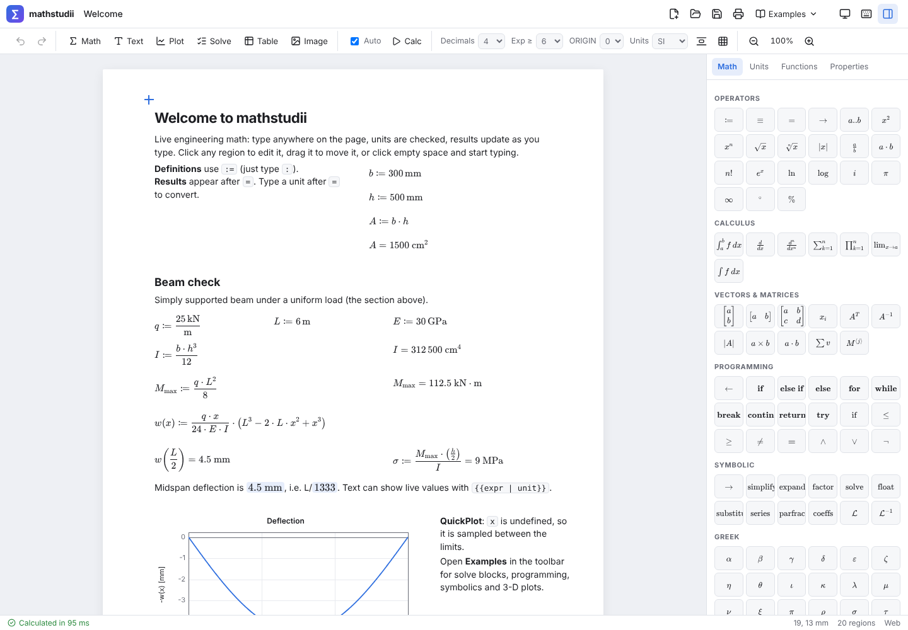
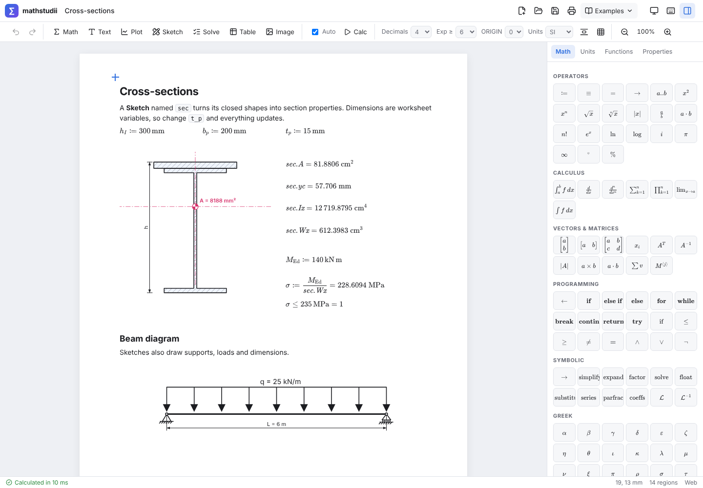

# mathstudii

Engineering calculation worksheets in the spirit of Mathcad, with a modern interface:
type math anywhere on an A4 page, results update live, units are checked, and the
same app runs on Windows, macOS, Linux, Android, iOS and in any modern browser.



```
b := 300 mm          h := 500 mm
I := b·h³/12         I = cm^4        →  312 500 cm⁴
w(x) := q·x/(24·E·I)·(L³ − 2·L·x² + x³)
w(L/2) = mm          →  4.5 mm
```

## Platforms

| Platform | How it ships | Status |
|---|---|---|
| Web (Chrome, Edge, Firefox, Safari) | Static site, works offline as a PWA | Built and tested here |
| Windows 10/11 | Tauri: `.msi` and `.exe` installers | CI workflow (`release.yml`), not run yet |
| macOS (Apple Silicon and Intel) | Tauri: `.dmg` / `.app` | CI workflow, not run yet; unsigned unless you add an Apple certificate |
| Linux | Tauri: `.deb`, `.rpm`, `.AppImage` | `.deb` built here (2.98 MiB); the other formats build in CI |
| Android | Tauri Android APK, or install the PWA | CI job (unsigned APK), not run yet |
| iOS / iPadOS | Install the PWA (Share → Add to Home Screen); native build via `npm run ios:build` on a Mac | The native build needs an Apple developer team for signing |

**Why this stack:** one TypeScript codebase renders in the OS's own web view
(WebView2, WKWebView, WebKitGTK, Android WebView). That keeps native installers
around 10 MB instead of the ~150 MB an Electron app bundles, and the same build
runs on the web with no changes. The math engine runs in a Web Worker. A long
calculation, or an accidental infinite loop, never freezes the UI, and you can
interrupt it (Esc / Stop), like Mathcad's interrupt.

## Using it

- Click empty space to place the cursor (**+**), then just type. `"` makes a text region, `@` a plot,
  `` ` `` a Python region.
- `:` types `:=`, `~` types `≡`, `Ctrl+.` types `→`, `Ctrl+G` makes the previous letter Greek.
- Enter finishes a region and moves the cursor below it. Drag a region to move it.
- Press **F1** for all keyboard shortcuts. **Examples** in the top bar has worked worksheets.
- **Right-click** a region for Edit, Cut/Copy/Paste, Duplicate, Delete, *Show result in…*,
  *Copy value*, a typo fix, Disable evaluation, front/back, align (several selected),
  Format and Properties. Right-click empty paper to insert any region there, paste,
  select all or recalculate.
- **Suggestions while typing:** functions and your own variables from the first letter
  (with the signature shown inside the brackets), units after a number (`10 k` → kN,
  kN/m, kNm, kPa …) or after a unit and `/`, and after `=` the units that fit the result,
  each with the converted value.

### Design checks

A comparison on its own line is a check: `M_Ed ≤ M_Rd`, `w ≤ L/250`, `0 < x ≤ 10`
(`<=`, `>=`, `<`, `>`, `==`, `!=` work too, with or without `=` at the end). It shows
both values, **✓ OK** or **✗ NOT OK**, and the utilisation (demand / capacity) in
percent; a failing check is tinted red. Vectors are checked element by element and
report the worst. The status bar counts the checks ("12 checks OK · max 87 %" or
"1 of 12 checks fail"); click it to jump to the failing (or most utilised) one.

### Sections and materials

| Function | Gives |
|---|---|
| `section("IPE 300")` | h, b, t_w, t_f, r, A, A_vz, I_y, I_z, W_el_y, W_el_z, W_pl_y, W_pl_z, i_y, i_z, I_t, I_w, mass, g (weight per m), surface |
| `steel("S355")`, `steel("S355", 50 mm)` | f_y, f_u (EN 1993-1-1 Table 3.1, reduced above 40 mm), E, G, ν, ρ, α_T, ε |
| `concrete("C30/37")` | f_ck, f_ck_cube, f_cm, f_ctm, f_ctk_005, f_ctk_095, E_cm, ε_c1 … ε_cu3, n (EN 1992-1-1 Table 3.1) |
| `timber("C24")`, `timber("GL24h")` | f_m_k, f_t_0_k, f_t_90_k, f_c_0_k, f_c_90_k, f_v_k, E_0_mean, E_0_05, E_90_mean, G_mean, ρ_k, ρ_mean (EN 338:2016, EN 14080) |
| `rebar("B500B")` | f_yk, E_s, k, ε_uk |
| `bars(4, 16 mm)` | area of 4 Ø16 bars (804 mm²) |

Use them as objects: `s := section("HEB 200")`, then `s.W_pl_y`, `s.I_z` (names with two
subscripts display as W_pl,y). Rolled sections: IPE 80–600, HEA/HEB 100–1000,
HEM 100–600. Hollow sections of any size: `CHS 168.3x5`, `SHS 100x5`,
`RHS 200x100x6.3` (hot finished, corner radii 1.5t / t).

How the numbers are made, honestly: section properties are integrated from the real
outline (root radii and corner radii as arcs) and the torsion constants use the
catalogue formulas. They agree with the ArcelorMittal tables to within 0.3 % (I_w uses
I_z (h − t_f)²/4). Concrete values come from the EN 1992 formulas, so they are not
rounded like the table (E_cm of C30/37 is 32.8 GPa, the table says 33). Check against
the edition your project uses. The same functions work in Python regions, and the beam
section list uses this library.

### Units in results

Results without a unit after `=` are shown in practical metric units chosen from what
the quantity is, not from mathjs' guess:

| Quantity | Shown in | Example |
|---|---|---|
| force | N, kN, MN | `q*L` → 60 kN |
| moment / torque | N·m, kN·m, MN·m | `q*L^2/8` → 45 kN·m (energy made from J, W or Wh stays J) |
| line load, stiffness | N/m, kN/m, MN/m | `3 kN/dm` → 30 kN/m, `1 kN/m^2 * 3 m` → 3 kN/m |
| area load | N/m², kN/m² | `5 kN / (2 m)^2` → 1.25 kN/m² |
| stress, pressure | Pa … GPa | `M/W` → 3.6 MPa |
| unit weight | kN/m³ | `7850 kg/m^3 * 9.81 m/s^2` → 77 kN/m³ |
| length, area, I, W | mm/m/km, mm²/m², mm⁴/cm⁴/m⁴ … | deflection → 0.2571 mm, `b*h^3/12` → 312 500 cm⁴ |

The prefix keeps the number at 1 or above. Type a unit after `=` (or pick one from the
list, or right-click → *Show result in*) to choose yourself; *Automatic* goes back.
Worksheets set to US or CGS units keep mathjs' own choice.

Typos get a fix: `3 kn` says *"kn" is not defined — did you mean "kN"?* and the
right-click menu changes it. `kNm`, `Nm` and `Nmm` are accepted as moment units. The
exotic SI prefixes ronto, quecto, ronna and quetta are switched off, so a typo like
`kN/rm` is an error instead of a silent 10⁻²⁷ m. (`kn` no longer means knot: use `knot`.)

### Tables and data

- **Paste from Excel** (or any tab-separated text) onto the page, or into a table cell.
  A header row with units such as `x [m]` or `F (kN)` becomes column names and units.
  Decimal commas (`1,5`) and thousands separators (`1.234,5`) are understood, and text
  labels (`G`, `HEB 200`) stay text.
- **Import CSV… / Export CSV** in a table (comma or semicolon separated). A dropped
  `.csv` or `.tsv` file becomes a table.
- **Columns as variables** defines every named column as a vector (`x`, `F` …) for
  plots and sums.
- Right-click a vector or matrix result → **Copy as table**, then paste it into Excel
  with its unit.

### Find, replace, rename

**Ctrl+F** finds text in every region: math, text, Python, solve blocks, plots, tables,
and the expressions inside sketches, beams and CAD parts. **Ctrl+H** adds replace.

- With *ab|* (whole names), `L` matches `L` and `L^2` but not `L_cr` or `Load`, so
  **Replace all** becomes a rename.
- Right-click a definition → **Rename everywhere** does the same in one step, and one
  undo reverts it.

### Version history

A snapshot of each document is kept every 10 minutes while you work and at every save
(the newest 60, in this browser). File menu (▾) → **Version history** lists them with
their size and region count.

- **Restore** brings one back. The state just before is kept as a snapshot, so a restore
  can itself be undone.
- **Open as copy** starts a new document from that snapshot.

### Printing a calculation sheet

Format tab → **Page header & footer** puts company, logo, project, subject, document
number, revision, made / checked by and date on every page, with *Page n of N*.
Printing (Ctrl+P, or "Save as PDF" in the print dialog) leaves out the empty pages after
the content.

### Saving

- **Autosave is on by default.** Every worksheet is kept in the browser's document store
  (IndexedDB) and saved there a moment after each change. Closing the tab loses nothing.
  The chip next to the title says where things stand: *Saved in browser*,
  *Saved · file.mstd* or *Saving…*.
- **Save (Ctrl+S) asks for a location once.** After that, Save writes to the same file
  without asking, and autosave keeps that file up to date too. This works in the desktop
  app and in Chromium browsers (Chrome, Edge), and the link survives reloads.
  - After a reload, Chromium wants one click on Save before the page may write the file
    again. The chip tells you when.
  - Firefox and Safari cannot write files from a web page, so there Save keeps the
    document in the browser, and **Download a copy** in the file menu gives you a file.
- **Save as… (Ctrl+Shift+S)** picks a new file.
- The **▾ menu next to Save** lists recent documents with their linked files, and has
  *Open file…*, *Save as…* and the **Autosave** switch. Opening a file that is already
  linked continues the same document instead of making a copy.

### Format

The **Format** tab in the side panel formats the selected regions:

- font size, bold, italic, text colour and a highlight
- line thickness of sketches, plots and beam drawings

Under *Whole worksheet* the same font size and line thickness apply to everything, along
with a sans-serif or serif text font. When bigger text makes regions overlap, they are
pushed apart automatically.

### Syntax

| You type | Meaning |
|---|---|
| `x := 3 m` | definition |
| `g ≡ 9.81 m/s^2` | global definition (evaluated before everything else) |
| `x =` / `F = kN` | evaluate / evaluate and convert to a unit |
| `x := 2·3 =` | define and show |
| `f(x, y) := x^2 + y` | function |
| `i := 0 .. 10`, `t := 0, 0.1 .. 2` | range variables (iterate every expression they appear in) |
| `v[i] := i^2` | element definition (subscript, honours ORIGIN) |
| `x_max` | literal subscript (part of the name) |
| `[1, 2, 3]`, `[1; 2; 3]`, `[1, 2; 3, 4]` | row vector, column vector, matrix |
| `A'`, `A^-1`, `det(A)` | transpose, inverse, determinant |
| `y'(t)`, `f''(x)` | derivative of a function (prime notation) |
| `3 + 4i` | complex number (`i` alone is an ordinary variable) |
| `x^2 - 1 → factor` | symbolic evaluation with a keyword |
| `integral(f(x), x, a, b)`, `diff(f(x), x)`, `sum(k^2, k, 1, n)` | calculus operators |
| `g` / `gm` | gravity 9.80665 m/s² / gram (Mathcad convention) |
| `log(x)` / `ln(x)` | base 10 / natural logarithm (Mathcad convention) |

Programs: end the first line with `:=` and indent the body (Shift+Enter for new lines):

```
fact(n) :=
  r ← 1
  for k ∈ 1 .. n
    r ← r · k
  return r
```

Supported: `if` / `else if` / `else`, `for … ∈ range|vector`, `while`, `break`,
`continue`, `return`, `try` / `on error`, and local `←` (or `<-`) including `v[k] ← …`.

### Differential equations

A solve block with `odesolve` as the solver solves ordinary differential equations,
Mathcad-style. Under **Constraints** write the equation in prime notation (or with
`diff(y(t), t, 2)`) and the conditions; the solver line names the unknown function:

```
Constraints:  m * u''(t) + c * u'(t) + k * u(t) = 0
              u(0 s) = 20 mm
              u'(0 s) = 0 mm/s
Solver:       u := odesolve(t, 5 s)
```

`u` is then a function like any other: `u(1 s) = mm`, `u'(0.25 s) = mm/s` and
`u''(t)` (from the state and the equation, not by differencing), in plots and in
other formulas. It interpolates between steps with the solver's continuous extension;
outside the interval it is an error ("u(6 s) is outside the solution interval 0 s … 5 s").

- **Units** come from the conditions (`u(0 s) = 20 mm` makes u a length and u′ a velocity).
  Conditions that are bare zeros take their units from the equation. Both sides of every
  equation must agree in units, written as `y''(t) = …` or not; an angle counts as a plain
  number (θ in degrees with `sin(θ(t))`).
- **Higher orders and systems**: any order is turned into a first-order system;
  `[x; y] := odesolve([x, y], t, 15)` solves several unknown functions together (orders may differ).
  The equations are solved for the highest derivatives at every step, directly when they are
  written as `y''(t) = …`, by a damped Newton iteration otherwise (`exp(y'(t)) = 1 + t`,
  `y'(t)^3 + y'(t) = 1` work). Conditions at the right end are integrated backwards.
- **Boundary value problems**: conditions at two (or more) points, such as a beam
  `EI * y''''(x) = q` with `y(0) = 0`, `y(L) = 0`, `y''(0) = 0`, `y''(L) = 0`, are solved by
  shooting: Newton on the unknown starting values, with sensitivities computed on a frozen mesh.
  When the solution grows too fast for that (a long beam on an elastic foundation,
  `EI * y''''(x) + k * y(x) = q` with λL ≈ 30), it falls back to multiple shooting: the
  interval is cut into 8 (then 32) pieces tied together by continuity.
- **Methods**: adaptive Dormand–Prince 5(4) with the worksheet's tolerance (`TOL`, as the
  relative error to each component's peak), switching to **Radau IIA** (implicit, order 5) when
  it detects stiffness — Van der Pol with μ = 1000 over 3000 s takes a fraction of a second.
  Besides the usual test at the explicit method's stability limit, a short run of Radau is tried
  now and then where the fastest mode is barely resolved, and kept when it strides much further:
  that catches forced stiff equations at tight tolerances (`τ y'(t) = cos(ω t) m − y(t)` with
  τ = 1 ms over 100 s), which the usual test misses.
  `odesolve(t, b, "radau")` asks for the stiff solver, `"rkadapt"` for the explicit one only,
  `odesolve(t, b, 200, "fixed")` for 200 classic RK4 steps; a number alone sets the minimum
  number of steps.
- **Messages** say what is wrong: `missing initial condition for y'`, a condition on y″ for a
  second-order equation, units of a condition that do not fit, a singularity (step size too small),
  boundary conditions that cannot be met or that leave the solution undetermined.

Mathcad's solution-matrix functions work too, with units in each component of y:
`rkfixed`, `Rkadapt`/`rkadapt`, `Bulstoer`/`bulstoer` (Bulirsch–Stoer), `Radau`/`radau`,
`Stiffb`/`stiffb`, `Stiffr`/`stiffr` (both solved with Radau IIA here; the Jacobian `J(x, y)`
is optional, numeric when left out), `AdamsBDF`, `Adams` and `BDF` (Dormand–Prince with
stiffness switching, Dormand–Prince, Radau). The lower-case forms
`rkadapt(y, x1, x2, acc, D, kmax, save)` return the solver's own steps.

The prime notation also differentiates ordinary functions: with `f(x) := x^3`, `f'(2) = 12`
(numerically, up to the fifth derivative). On a matrix `A'(x)` keeps its old meaning,
transpose times x. Not covered: partial differential equations (`Pdesolve`), delay equations,
differential-algebraic systems (an equation without a highest derivative is reported).

### Special functions

Bessel functions of any real order `Jn(m, x)`, `Yn`, `In`, `Kn` (and `J0` … `K1`), spherical
`js(n, x)`, `ys(n, x)`; Airy `Ai`, `Bi`; `gamma(x)` and the upper incomplete `gamma(a, x)`,
`gammainc(a, x)` (lower), `gammaP`, `gammaQ` (regularised), `beta`, `ibeta(z, a, b)`
(regularised incomplete beta), `betainc`, `lgamma`, `digamma`, `Psi(x)` / `Psi(n, x)` (digamma
and polygamma), `zeta`; `erf`, `erfc` (accurate
in the tail), `erfinv`, `erfcinv`; exponential and trigonometric integrals `Ei`, `E1`,
`En(n, x)`, `Si`, `Ci`, Fresnel `FresnelS`, `FresnelC` (∫ sin(πt²/2)); elliptic integrals
`ellipK(k)`, `ellipE(k)`, `ellipE(φ, k)`, `ellipF(φ, k)`, `ellipPi(n, k)`, `ellipPi(n, φ, k)`
with the **modulus k** (parameter m = k²) and φ in rad or deg; `LambertW(x [, −1])`;
orthogonal polynomials `Leg(n, x)` / `Leg(n, m, x)` (associated, with the (−1)ᵐ phase),
`Her` (physicists'), `Lag(n, x)` / `Lag(n, α, x)`, `Tcheb`, `Ucheb`, `Jac(n, a, b, x)`; `sinc`.
Distributions add `dF`, Weibull, lognormal, gamma, beta, geometric, negative binomial,
hypergeometric, Cauchy and logistic (`d…`, `p…`, `q…`, Mathcad's arguments), and `qbinom`,
`qpois`; `pnorm`, `pbinom` and `ppois` keep their digits in the tails. The algorithms
are the standard ones (Steed/Temme and Hankel asymptotics for Bessel, Lentz continued
fractions, Carlson's symmetric integrals, Euler–Maclaurin for ζ) and are tested against
DLMF / Abramowitz & Stegun values and checked against 40-digit mpmath values on a few thousand
points: within 1e-12 relative (most within 1e-14); near zeros of an oscillating function (Bessel
J, Y of large order) only the absolute error is that small, while the positive roots of ψ and Ei
keep full relative accuracy. Orders in the hundreds lose more: J, Y and I of order 1000 are good to
about 1e-10 relative (Y near a zero less), and ψ⁽ⁿ⁾ of high n at negative x, which is badly
conditioned there, to about 1e-8. The display uses textbook notation (J_m(x), P_n^m(x), K(k) …).
On vectors and matrices they work element by element (`J0([1, 2])`, `pnorm(v, 0, 1)`).
A worksheet variable with one of these names (say `Si := 3 m`) still works as a variable.

### Sketches (drawing)

Press **Sketch** (or type `#` at the cursor) for a vector drawing region with lines,
polylines, rectangles, circles, arcs, arrows, dimensions, text and freehand. It also has
kinematic links, supports, joints, sliders, springs, dampers, loads, and parametric
cross-sections (rectangle, circle, tube, box, I, T, channel, angle). Snapping covers grid
points and endpoints (hold Alt to turn it off), and Shift constrains angles. A drawing has no
zoom of its own: drag the sketch's corner handle to resize it, and the drawing scales with it.
Regions below are pushed down.

- **Section properties:** give the sketch a name such as `sec`, and its closed shapes
  (solids minus holes) define `sec.A`, `sec.xc`, `sec.yc`, `sec.Ix`, `sec.Iy`, `sec.Ixy`,
  `sec.I1`, `sec.I2`, `sec.θ`, `sec.J`, `sec.Wx`, `sec.Wy`, `sec.rx`, `sec.ry` with units.
- **Parametric drawings:** any number in the Properties panel also accepts a worksheet
  expression (`h_I/2 + t_p/2`, `r cos(θ)`), so the drawing follows the math.


- **Animation:** set a variable and a from/to range in the sketch's Properties, then
  press ▶ to sweep it. This is how the crank-slider example moves.

### Beams and frames

Press **Beam** for a structural analysis region: draw a beam, a continuous beam, a
truss or a plane frame, put supports and loads on it, and read the reactions and the
N, V, M and deflection diagrams right on the drawing.

**Drawing** (double-click the region to edit; the toolbar sits above it):

- **Member (B):** click point after point; a chain continues until Esc or a right-click.
  Points snap to the grid, to existing nodes, and onto members, which are split there.
- **Supports:** **Pin (P)** holds x and y, **Roller (R)** holds one direction, and
  **Fixed (X)** also holds rotation. Turn a support in the panel for walls or slopes;
  inclined rollers work.
- **Hinge (G):** click a node to let its members turn freely. A member hinged at both
  ends is a truss bar.
- **Force (F)** and **Moment (M):** click a node or any point on a member. A value field
  opens at the load: type `20` (the force unit) or any worksheet expression (`P_d`,
  `1.5 * q_k * 2 m`).
- **Line load (Q):** click a member for a full-length load, or drag along it for part of
  it. Loads can be uniform or linearly varying, and act downwards (gravity, per length of
  member) or perpendicular to the member.
- **Select (V):** drag nodes, and double-click a load to change its value. Delete removes
  the selection.

**Results:** the diagrams are drawn neatly **under the beam**, textbook style, one panel
each for N (only when there is axial force), V, M and δ. They share the beam's horizontal
scale, and dashed guide lines drop from the supports and point loads through every panel.
Values are labelled at supports, jumps and extremes. Moments are drawn on the tension side
(sagging below the line), shear and tension positive above, and deflection as it goes.

- The strip under the panels switches diagrams on and off, and **Reactions** adds the
  support reactions to the drawing.
- A frame gets one small copy of the structure per diagram, in a grid.
- **On structure** switches to the other layout: one diagram at a time, drawn on the
  members.
- The region grows to fit the panels when they first appear (regions below move down),
  and it can be resized freely afterwards. The whole drawing scales with its frame like
  a picture: structure, diagrams, text, lines and symbols together. Plots do the same
  with their text and lines. The panel lists the reactions, the extremes, the bending
stress (with a section modulus W) and the degree of static indeterminacy.

**Sections:** IPE/HEA/HEB profiles from a list, or any E, A, I and W. All four are
expressions; bare numbers mean GPa, cm², cm⁴ and cm³. Each member can have its own section.
A material (steel, or a concrete or timber class, which also sets E) gives the shear
modulus.

**Back into the worksheet:** name the region (`b`) and the math below can use
- the reactions per support: `b.A.Ry`, `b.A.Rx`, `b.A.M`, `b.A.R`
- the extremes: `b.M_max`, `b.V_max`, `b.N_max`, `b.w_max`, `b.σ_max`
- for a straight beam, the functions `b.M(x)`, `b.V(x)`, `b.N(x)` and `b.w(x)`, plus the
  length `b.L`. That gives a plot of the moment line in one line, or checks at any section.

**How it is solved, and how exact it is.** The structure is solved with the direct
stiffness method: Euler–Bernoulli members, linear elastic, small displacements, so
statically determinate and indeterminate structures are handled alike.

- Supports are constraints with Lagrange multipliers, so the multipliers are the
  reactions themselves.
- Hinges are moment releases by static condensation.
- Members are split where loads sit, so each piece carries at most a linear line load.
  For such pieces the stiffness method is exact at the nodes. N, V and M along a member
  come from statics as exact polynomials, and the deflection is the exact double integral
  of M/EI. The answers therefore match the handbook formulas, not just approximate them:
  the tests check simply supported, cantilever, propped, continuous and Gerber beams
  and a truss against closed-form results, and a portal frame for equilibrium.
- **Not included:** plasticity, imperfections (add equivalent sway forces as loads),
  lateral-torsional and out-of-plane buckling, and self-weight. Add self-weight as a
  line load.

**Shear deformation, second order and buckling** (side panel → *Analysis*; all off by
default, so older worksheets give the same numbers):

- **Shear deformation:** Timoshenko members, φ = 12EI/(G A_v L²). G = E/2(1 + ν) with
  ν = 0.3 for steel and 0.2 for concrete; timber uses G_mean of its class (E/16 without
  one), or type G. The shear area is EN 1993-1-1 6.2.6(3) for the listed profiles
  (A − 2b t_f + (t_w + 2r) t_f, at least h_w t_w), else a rule: rectangle 5/6 A, solid
  circle 0.9 A, circular hollow 2A/π, rectangular hollow A h/(b + h), welded I h_w t_w, or
  a value. Fixed-end forces and deflection lines stay exact.
- **Second order (P-Δ and P-δ):** every case and combination is solved on the deformed
  structure. Members are cut into 4–8 elements with the consistent geometric stiffness of
  their axial force (varying linearly along each element, so a column's own weight counts
  properly), and the axial forces are iterated until the displacements change by less
  than 10⁻⁶. The shear V is then the force across the deformed member axis (dM/dx).
  Loads at or above the critical load are reported (α_cr ≤ 1, a stiffness turning
  negative, or no convergence in 30 iterations) and only the buckling mode is drawn; a
  combination that fails does so on its own, and then the governing values are withheld.
  The panel shows how much M_max and δ_max grew against first order, next to
  1/(1 − 1/α_cr).
- **Buckling:** for each combination the three lowest load factors α_cr from
  (K + α K_G(N)) φ = 0 with the first-order axial forces (supports eliminated, hinges with
  their own rotation, a banded Cholesky factor, then dense eigenvalues or Lanczos). The
  panel gives α_cr per combination with the EN 1993-1-1 5.2.1(3) verdict (≥ 10: first
  order is enough, ≥ 15 for a plastic analysis; 3–10: second-order effects count, or the
  1/(1 − 1/α_cr) amplification of 5.2.2(5)B for sway; < 3: second order required), and
  the buckling length of each compressed member, L_cr = π √(EI/(α_cr |N|)). **Buckling**
  in the strip draws the mode (normalised), with a selector for modes 2 and 3.
- **In the worksheet:** `b.alpha_cr` (`b.α_cr`, the lowest over the ULS combinations),
  `b.alpha_cr_modes` (a vector), `b.L_cr` (a vector in member order; ∞ for members in
  tension), per combination `b.combos.ULS.alpha_cr`, and with second order the
  first-order values beside the results: `b.first.M_max`.
- **Checked against closed forms:** Euler columns with β = 1, 2, 0.699 and 0.5 and the
  second mode (within 0.5 %), Engesser's shear-flexible column, pinned- and fixed-base
  sway portals (Timoshenko & Gere), the Timoshenko cantilever δ = PL³/3EI + PL/GA_v and
  propped cantilevers, the cantilever column δ = H (tan kL − kL)/(P k) and the
  beam-column under a uniform load with its exact amplification, M(x) and V(x) along a
  beam-column under a point load, and Greenhill's column under its own weight
  ((qL)_cr = 7.837 EI/L²).

**Load cases and combinations.** Side panel → *Use load cases & combinations* splits the
loads into cases (G permanent, Q imposed, wind, snow …; pick a load's case in its value
box or the side panel) and combines them with factors — numbers or worksheet
expressions such as `γ_G`. The default set is ULS 1.35 G + 1.5 Q and SLS G + Q.

- Every case and every combination is solved on its own, with factored loads. That is
  exact for a linear structure, unlike superposing sampled diagrams.
- The strip under the beam picks a case, a combination or the **envelope**: N, V and M
  over the ULS combinations, deflection over the SLS ones, sampled on the union of all
  stations with both sides of every jump. Max is drawn solid, min dashed. Loads that do
  not act in what is shown are faded; G and Q on one span are stacked.
- The worksheet gets the governing values (`b.M_max` over ULS, `b.w_max` over SLS,
  reactions from the ULS combination with the largest resultant) plus every case and
  combination on its own: `b.combos.ULS.M_max`, `b.cases.Q.A.Ry`.

**Springs and settlements.** A support can be elastic along its axis (spring k, drawn as
a coil), settle by a given amount (into the support, e.g. 10 mm down), and a fixed support
can have a rotational spring (a semi-rigid foot). Springs go into the stiffness matrix,
settlements are prescribed displacements; both are checked against closed-form results.

**Influence lines and moving loads** (side panel → *Influence lines* and *Moving loads*):

- **Influence lines** of a support reaction (R_y, R_x or the moment of a fixed support),
  or of M, V, N or the deflection at a section, drawn in panels under the diagrams
  (positive up, ordinates labelled at the peaks, at supports and on both sides of the
  shear jump; M in kN·m per kN, deflection in mm per kN). A unit load walks along the
  **load path**: a straight beam, or the members marked *Load path (deck)* (with none
  marked, the horizontal ones), which must form one chain from left to right. The
  stiffness is factorised once and every position is one more right-hand side: the
  fixed-end forces of the load on its member, so members stay whole and the ordinates
  are exact at every position (the forces along members come from statics). Positions
  are every Δx along x (automatic: a round step near 1/200 of the path that the axle
  spacings divide, on a long path a whole fraction of the spacing such as 0.6 m for LM1;
  a step asked for is kept between 1/10 of the path and 600 positions), plus member ends
  and the sections asked for.
- **Moving loads:** a point load; **EN 1991-2 Load Model 1** for one notional lane
  (tandem 2 × α_Q·300 kN at 1.2 m and α_q·9 kN/m² × the lane width, α = 1 by default);
  a crane (two wheels P at a); or any axle train with a uniform load. A train stops with
  each of its axles on every position, both ways (or one way): with the lines straight
  between positions those stops are where its extremes are, so none falls between them. The
  uniform load goes only where the influence line is adverse (Simpson's rule on each
  smooth stretch, which is exact for the cubic lines of unloaded members; where the line
  changes sign, the cubic through the nearest four ordinates cut at its zero). The result
  is an envelope (upper and lower bound, the load may also be absent) of N, V, M, the
  deflection and the reactions, with the section and the train position of each
  extreme.
- **In the combinations** each moving load has a factor column next to the load cases;
  a combination then has two bounds: its static solution plus the factored moving
  extreme at each station (the overall envelope includes both). A new moving load gets a
  factor (1.35 for LM1 and cranes, else 1.5; 1 at SLS) only in the combinations that
  have no moving load yet; several moving loads in one combination add their extremes
  (on the safe side, not position by position). Moving loads are linear: with second
  order on, they are added to the second-order static part as first-order results, and
  buckling sees the static loads only. If the moving-load analysis fails (say the load
  path is not one chain), the region says so and the combinations go on without them.
- **The strip** picks a moving load's envelope like a combination; **Train** places the
  train on the structure with a slider (and a direction button): the diagrams become
  those of the train at that position, and the influence-line panels mark each axle
  with Σ P η.
- **In the worksheet:** `b.IL.M1(x)`, exact between positions too (the line is one cubic
  between joints, kinks and jumps, read through its four nearest ordinates), with
  `b.IL.M1_max`, `_min` (a crest between positions included) and the ordinates as
  vectors `b.IL.M1_x`, `b.IL.M1_eta` (a position repeated at a jump); per moving load
  `b.moving.LM1.M_max`, `M_min`, `V_max`, `V_min`, `w_max`, each with `x_M_max` (the
  section) and `pos_M_max` (the first axle), the reactions `b.moving.LM1.B.Ry_max`,
  `.Ry_min`, and the envelope as functions `b.moving.LM1.max.M(x)`, `.min.M(x)`; a
  combination's lower bound is `b.combos.ULS.min`.
- **Checked against closed forms:** influence lines of M (peak L/4), R_A and V (jump of
  1) on a simple span, Maxwell's deflection line, R_B of two spans against
  Müller-Breslau ξ(3L² − ξ²)/2L³, the clamping moment of a propped cantilever
  ξ(L − ξ)(2L − ξ)/2L², the straight lines of a Gerber beam, and a frame with a hinge, a
  spring and an inclined roller (and a beam drawn right to left) against the direct
  solver; PL/4 for a single load, P(2L − a)²/8L for two axles (and PL/4 for a > 0.586 L),
  R_A = P + P(L − a)/L, −qL²/8 over the middle support and 49/512 qL² in a span for a
  uniform load on the adverse parts, −0.0736 qL² at 0.9 L with span 1 partly loaded
  (both spans full give only −0.0675 qL²), and LM1 on a 20 m span by hand
  (852 x − 43.5 x²).
- **Limits:** loads act vertically on the path; axle spacings and uniform loads are per
  metre along x (plan length on an inclined deck); sections are searched at the load
  positions, and the axles of a train stand on positions together only when Δx divides
  their spacings (otherwise between two positions the line is taken straight: an error
  of order Δx²); dynamic factors, multiple lanes and transverse distribution are left to
  you (scale α or the loads). The influence-line panels show in the *Under* layout only,
  and *Train* draws the axles (a uniform load has no one position).

The **Beams and frames** example covers four structures:

- A two-span beam with factored loads, its reactions, a stress and deflection check, and
  plots of `b.M(x)` and `b.w(x)`.
- A portal frame with fixed feet under roof load and wind.
- Pattern loading: G on both spans, Q on either, three ULS combinations and the envelope.
- A sway portal on pinned feet in second order with shear deformation: α_cr, the buckling
  mode, the column's buckling length and the amplified corner moment.

The **Bridge girder** example is a two-span girder (2 × 25 m) under G and LM1: three
influence lines, the LM1 extremes with where they act, the ULS envelope 1.35 G + 1.35 LM1,
and a hand check of the hogging moment over the middle support.

### Python code

Press **Python** (or type `` ` `` at the cursor) for a code region. It runs real CPython
(Pyodide, compiled to WebAssembly) inside the app, with the worksheet:

- **Variables in.** Everything defined *above* the region is a Python variable, units
  included: `q := 10 kN/m` arrives as a `Quantity`. Vectors and matrices arrive as lists,
  objects (beam and CAD results) with attribute access (`b.M_max`), and worksheet
  functions are callable.
- **Variables out.** What you assign with `=` or define with `def` (outside loops and
  functions) becomes a worksheet variable for the regions below, so a Python function
  works in math regions and plots: `sigma(500 cm^3) = MPa`. Loop temporaries and names
  starting with `_` stay private.
- **Units.** Arithmetic checks dimensions (`L + 2` with `L` in metres is a `TypeError`).
  `Q(5, "kN")`, `u.mm`, `u("kN/m")` make quantities; `M.to("kN*m")` gives a plain number;
  `f"{M:.1f kN*m}"` formats one. Angles are plain numbers in radians (`u.deg` = π/180).
- **Output.** `print` shows under the code, then the exported values. Errors name the line.
  The arrow next to *Python* hides the code and keeps the results.

The honest part:

- The first run starts Python, which takes a few seconds (about 13 MB, cached after that,
  so it also works offline).
- numpy, scipy, sympy, pandas and the other packages Pyodide ships are downloaded from
  the Pyodide CDN the first time a region imports them, so that first import needs internet.
  Packages with native code that Pyodide does not ship cannot be used.
- A region that never ends (`while True:`) blocks the calculation like an endless
  worksheet loop: press *Esc* (or *Stop*) to interrupt, then fix the code.
- Quantities hold one value; for numpy work, convert with `.to(...)` first and wrap the
  result again with `Q(...)`.

### CAD parts (parametric design)

Press **CAD** (or type `&` at the cursor) for a parametric part. A part is a small
Fusion-style design: components with a feature timeline, sketches on planes or faces,
solid features with booleans, and an assembly held together by joints. It is linked to
the worksheet in both directions.

**The CAD window.** Parts are edited in a separate window next to the worksheet (a browser
window, or a native window in the desktop app). On phones and small tablets the same
workspace opens full screen in the page. Its layout follows Fusion:

- **Toolbar tabs:** Solid, Assemble, Inspect and File. While a sketch is open they become
  Sketch and Constrain, with a green **Finish sketch** button.
- **Browser** (left): components (the radio button marks the active one) with their bodies
  and sketches, occurrences and joints. Each item has a visibility toggle.
- **3-D viewport** (WebGL, Z up): drag to orbit, Shift or middle drag to pan, wheel to
  zoom at the cursor. The ViewCube's faces, edges and corners jump to views. Shaded,
  shaded-with-edges and wireframe display.
- **Dialog / properties** (right): feature and joint dialogs, or the properties and mass
  properties of the selected component, body, occurrence, joint or timeline item.
- **Timeline** (bottom): the active component's sketches and features in order. Click to
  select, double-click to edit. The marker rolls the model back (⏮ ◀ ▶ ⏭, or **Roll back
  to here**). Features can be suppressed or deleted; new ones go in at the marker.

**Modelling** (Solid tab):

- **Sketch:** click an origin plane (XY, XZ, YZ, with an optional offset expression) or any
  flat face of a body. The sketch opens looking straight at its plane. The bodies it cuts
  show as grey reference outlines, and **Project** turns them into fixed sketch geometry
  (circles come back as circles).
  - A sketch on a face follows the face. Make the base taller and the sketch, with the
    holes and bosses on it, moves up. Make it wider and the sketch stays where it was:
    its origin is the component origin projected onto the face.
  - When that origin lands on a corner of the face or the centre of a circular edge (a
    base drawn from the origin, a disc centred on it), the sketch keeps to that point:
    move the base or the disc in its plane and the sketch goes along. Otherwise it keeps
    its place in the plane, as in Fusion.
- **Extrude:** one side, symmetric, two sides or through all. Operations are new body,
  join, cut or intersect. Click profiles in the view to pick them and bodies to choose
  targets. Cuts go into the material automatically: both directions are tried and the one
  that removes more is kept.
- **Revolve:** about the sketch axes or any sketch line, any angle, in either direction.
- **Hole:** at sketch points — simple, counterbore or countersink, a depth or through all.
  **Tapped** picks an ISO metric size: the hole is drilled to the tap drill (8.5 mm for
  M10) and threaded to a depth, cosmetic (rings in the view) or modeled.
- **Sweep:** a sketch profile along a path — a chain of sketch lines, arcs and circles, a
  chain of body edges (they follow edits) or the helix of a coil. The profile stays
  perpendicular to the path (corrected Frenet) or parallel to itself; a twist angle or an
  end scale (taper) on open paths. A path that makes the swept profile run into itself says so: *the profile
  reaches 6 mm from the path, but the path bends with a radius of 4 mm: the sweep would
  cut through itself*.
- **Coil:** a helix on an origin, sketch or construction plane (or a flat face) at a
  centre point: diameter, then revolutions and height, revolutions and pitch, or height
  and pitch; left or right hand; a circle, square or triangle section inside, on or
  outside the diameter. Path only gives just the helix, for a sweep to follow.
- **Thread:** ISO metric coarse and fine (ISO 261/262, M1.6 to M64, profile by ISO 68-1)
  on picked cylinders: external on a shaft, internal in a hole, the size suggested from
  the diameter. Cosmetic threads are listed in the inspector and drawn as rings; modeled
  ones cut the real groove (it takes a few seconds).
- **Pattern:** rectangular (one or two directions) or circular, of features (the copies
  repeat the boolean) or of bodies.
- **Mirror:** features or bodies, about an origin plane, a sketch plane or a construction plane.
- **Combine:** join, cut or intersect bodies, optionally keeping the tools.
- A dialog edits the real feature, so the model previews every change; Cancel rolls it back.

**Construction geometry** (Construct group) sits in the timeline and in a *Construction*
folder of the browser, drawn orange in the view, and follows edits through its references:

- **Plane:** offset from a plane or face, at an angle about an axis or edge, midplane of
  two, through three points, tangent to a cylinder at an angle, normal to an edge or a
  sketch path at a fraction of its length.
- **Axis:** through two points, along an edge, through a cylinder or cone, normal to a face
  at a point. **Point:** a vertex, the centre of a circle or sphere, where an edge crosses
  a plane.
- Sketches, mirrors, patterns, splits, drafts, coils and joints take them like origin
  planes and axes.

**Modify** (Solid tab, as in Fusion; they need the B-rep kernel). Edges, faces and bodies
are clicked in the view while the dialog is open (click again to take one out); what is
picked before pressing the button is used. They store references to what they picked, so a
base made longer keeps its rounded edge rounded. Every size is a worksheet expression.

- **Fillet (F):** sets of edges, each with a radius, or with an end radius for a radius that
  changes linearly along the chain (from its end with the smaller x, then y, z). A face adds
  all its edges; clicking a rounding takes its edge out. A radius too large says so:
  *radius 12 mm is too large for the edge between the end face and the side face of
  Extrude1 (max ≈ 10 mm)* (the estimate is for straight edges between flat faces). Two
  sets with different radii on one tangent chain are refused (the chain takes one radius).
- **Chamfer:** equal distances, two distances, or a distance and an angle. The first
  distance (and the angle) is measured on the face of each edge that comes first by name;
  Flip takes the other one.
- **Shell:** walls of a thickness inside or outside, with the picked faces open, or with
  none picked a closed void inside the body. A rounding thinner than the wall vanishes
  inside: the inner walls meet at a sharp edge, as in Fusion.
- **Draft:** faces tilted about where they meet a neutral plane (origin plane, sketch plane
  or a picked face), pulled along its normal or along an axis; a positive angle narrows the
  part towards the pull direction.
- **Press pull (Q):** flat faces moved along their normal (out adds material, a negative
  distance removes it), cylinders grown or shrunk (a hole's wall pulled out makes the hole
  smaller). The face keeps its name, so a sketch on it follows. Flat faces move as an
  offset, as in Fusion: the flat faces around one that stay are extended up to it (a
  chamfer or a drafted side goes on), and faces moved together meet where their moved
  planes meet (pulling the top and a side of a box gives the larger box).
- **Split body:** by an origin plane with an offset, a sketch plane or a flat face. The piece
  behind the plane stays the body; the others become new bodies.
- **Move/Copy:** bodies turned about an axis (origin axis, sketch line, a picked edge or
  cylinder), then moved by ΔX, ΔY, ΔZ; Copy keeps the original.
- Sizes preview while you type (after a short pause, at once on Enter).
- Editing one from the timeline rolls the timeline back to it while the dialog is open; OK,
  another dialog or closing the window rolls it forward again.

**Assemblies** (Assemble tab):

- **New component** adds a component and makes it active. **Insert copy** adds another
  occurrence of the active component.
- **Joints:** rigid, revolute, slider and cylindrical. A joint origin is either picked on
  the model or chosen from a list: the component origin, or any sketch point or circle
  centre with Z along the sketch normal or a sketch axis.
  - Picking works as in Fusion. Hover a face or edge and its snap points show as small
    glyphs: the face's centre, a cylinder's axis, circle and arc centres, edge midpoints
    and vertices. The one nearest the pointer is marked with its Z axis, and a click
    takes it.
  - A joint on a snap point follows its geometry. Move or resize the hole a pin sits in,
    and the pin goes with it.
  - The angle and offset are worksheet expressions, so a calculation can drive the
    mechanism. A slider drives revolute joints by hand.
  - **Flip** makes mating faces point at each other.
- **Placement:** grounded occurrences stay fixed and joints carry the rest along the joint
  tree. A joint that closes a loop which does not fit is reported, not forced.
  Unconstrained occurrences take typed positions and rotations.
- **Interference** lists overlapping occurrences with the shared volume.

**Inspect:** measure between picked points (snapping to corners, with the line drawn in
the view); **Section** cuts every body with the XY, XZ or YZ plane at any position, with
the cut faces in colour (Flip keeps the other half); mass properties of the assembly,
each component and each body (volume, mass, centre of gravity, inertia tensor); overall
size.

**Extrude options and Loft:**

- **Thin (shell):** only a wall of thickness t along the outline (inside, outside or
  centred), with a closed start (an open box), closed end, both or none (a tube).
- **Rounded or chamfered edges** at the start and/or end of an extrusion: the profile is
  offset into the material in layers (a quarter circle for a fillet) and the layers are
  joined vertex to vertex. A radius too large for the profile is refused.
- **Loft** joins the first profile of one sketch to the first profile of another, on a
  different plane, with a ruled surface (a square to a circle, for example).

**Drawings:** right-click a part → **Make a drawing**. You get a sheet (A4 or A3
landscape) with:

- front, top and side views in first-angle (ISO) or third-angle projection, plus an
  isometric view;
- visible lines solid and hidden lines dashed, with overall dimensions;
- a standard scale and an ISO 7200-style title block with the projection symbol.

The drawing follows the part. Select it to print at true scale (or save it as PDF), or
to export SVG or DXF (layers VISIBLE, HIDDEN, DIM, FRAME). The lines are the mesh's
sharp edges and the silhouettes of curved walls. Each line is tested in short pieces
against every triangle in front of it, then merged, so hidden pieces that lie under
visible lines disappear.

**The 2-D sketcher** (also used for every sketch):

- **Navigation:** the wheel zooms at the cursor, middle or right drag pans, F fits.
- **Grid and snapping:** the grid adapts to the zoom (1-2-5 steps) and grid snap is optional.
  Snaps to endpoints, midpoints, centres and curves show markers, and alignment guides
  appear when you line up with other points.
- **Typing sizes:** type while drawing to give exact sizes. For example, line → `100`
  Tab `30` Enter draws a 100 mm line at 30° with its dimensions.
- **Selecting:** drag right for window select, drag left for crossing select.
- **Sketching:** line chains, corner and centre rectangles, circles, centre and
  3-point arcs, regular polygons, slots, points and construction geometry.
  - New points snap to existing points (shared, so outlines are connected), to
    midpoints (with a midpoint relation) and onto curves.
  - Nearly horizontal or vertical lines get that constraint automatically.
  - Each tool adds the relations that keep its shape: a polygon stays regular, a slot
    stays tangent, a centre rectangle stays centred.
- **Modify:**
  - **Fillet** keeps a virtual sharp, so dimensions to the corner survive.
  - **Trim** splits at crossings and turns circles into arcs.
  - **Mirror** creates the copies with symmetry relations.
- **Constraints:** coincident, point on line/circle, horizontal, vertical, parallel,
  perpendicular, tangent, equal, midpoint, symmetric, concentric and fix.
- **Dimensions:** length, distance (aligned, horizontal, vertical, point to line), angle,
  radius and diameter. They can be driving or reference. Names are unique across the part.
- **Solver:** a Levenberg–Marquardt solver keeps every constraint while you drag
  geometry, and moves the geometry as little as possible.
- **Constraint status:** the rank of the constraint Jacobian gives the degrees of freedom.
  Under-defined geometry is drawn blue and fully defined geometry black. Conflicting
  constraints are red, and redundant ones are reported.

**Linked to the worksheet:**

- **Worksheet → part:** dimensions, extrude distances, angles, hole sizes, pattern counts,
  plane offsets, densities and joint values are all worksheet expressions (`d/2`,
  `b_p + 5 mm`, `30 deg`, `n_b`), so the design follows the calculation above it.
- **Part → worksheet:** name the part (`asm`) and the math below can use
  - the whole assembly: `asm.V`, `asm.m`, the centre of gravity `asm.xg` …, the mass moments
    of inertia `asm.Imx` … `asm.Imyz`, and the overall size `asm.Lx`, `asm.Ly`, `asm.Lz`
  - each component, `asm.Flange.m`, and each body, `asm.Flange.Body1.V`. A single-component
    part puts its bodies and sketches directly on the part.
  - each sketch's section, `asm.Disc.A`; the first sketch's section is also on the part
    itself (`shaft.A`, `shaft.Ix`, `shaft.Wx` …)
  - every named dimension (`asm.D_f`) and every moving joint (`asm.Spin` in degrees, a
    slider in length)
  - each thread and tapped hole: `bolt.Thread1.P`, the pitch diameter `d2`, the minor
    diameters `d1` (nut) and `d3` (bolt), the stress area `As` = π/4·((d2+d3)/2)² and the
    tap drill `drill`
- **Live:** edits travel to the worksheet at once, which recalculates and sends the results
  back. Undo in the CAD window applies to the part only. The worksheet window must stay
  open, since it owns the document. The page shows the 3-D model, the first sketch, or both.

**The kernels and their accuracy.** The worksheet's values come from a B-rep kernel,
[OpenCascade](https://dev.opencascade.org/) (the WASM build made for replicad, LGPL-2.1):
arcs and circles stay true circles, cap fillets are real rolling-ball fillets, a
countersink is a true cone, and volume, centroid and inertia are surface integrals over
the exact faces. The tests check them against closed forms to 10⁻⁹ (a fillet round a
box, a torus by Pappus, a countersunk hole, a pyramid frustum loft). The kernel is big
(7 MB compressed), so it loads in the background the first time a worksheet has a CAD
part with a feature (or a CAD window opens), only in a worker, and is cached after that
(offline too).

Until it has loaded, or where it cannot, [Manifold](https://github.com/elalish/manifold)
(WASM, Apache-2.0, 0.5 MB, also loaded only for a worksheet with a part) builds the parts. It keeps every solid a closed 2-manifold, so
booleans never leave cracks. Curves become polygons with a vertex every 2°, so volumes of
booleaned bodies are within about 2·10⁻⁴ of the true solid (a cylinder comes out ~0.02 %
small). The values refresh by themselves once OpenCascade is ready. If it cannot load,
Manifold also draws the parts, and the views say so (*Mesh kernel*); STEP export then
waits for OpenCascade. The two kernels build the same features, with three known
differences: lofts pair the two profiles differently (OpenCascade corner to corner, from
the corners that match, Manifold at equal arc lengths: a rectangle-to-circle duct differs by
~0.1 %, a square to a square turned 45° by ~10 %), thin walls keep corners sharper than ~29° pointed in OpenCascade where Manifold
bevels them, and a few borderline roundings one kernel accepts the other refuses.

**Never in the way.** All kernel work runs in a worker; the page itself loads no kernel:

- The calculation worker builds the parts for the worksheet, then sends each design's
  display data (meshes, faces, edges) once. A math-only edit sends nothing and rebuilds
  nothing.
- **Incremental rebuilds:** every step of a timeline keeps what it built. Changing a
  feature rebuilds it and the features after it. Rolling the timeline marker back and
  forth, renaming, recolouring, panning a sketch or moving a dimension's label rebuilds
  nothing, and a value changed and changed back finds its earlier build again. For
  example, a new body on a plate with 60 counterbored holes rebuilds in 25 ms instead of
  2.1 s.
- Typing in the worksheet stays smooth while a heavy part rebuilds. With a 40-hole flange
  rebuilding, the page's longest task was 57 ms, against 2.8 s when the page built parts
  itself.
- Section views, sketch outlines, measuring, interference, drawings and exports are
  requests to the worker. In a separate CAD window, a kernel worker of its own answers.
  The views show *Loading the 3-D kernel…* or *Rebuilding…* meanwhile.
- If that worker fails (an error escapes it), whatever it was asked fails with a message,
  and the next request starts a fresh one. A view whose part was being built asks once
  more; if the kernel stops on it again, the view says why instead of waiting. If neither kernel can load, the worksheet and
  the CAD window both say *No 3-D kernel*.

**Exact display and selection.** The 3-D views draw the B-rep: curved faces are smoothly
shaded, and edges are the true edges as crisp lines (no seams). In the CAD window:

- **Picking:** faces and edges light up under the pointer; edges within 5 px win.
- **Selection:** click picks a face or edge, Shift-click adds one or takes it out again,
  Esc clears it.
- **Inspector:** shows what is picked:
  - surface or curve type, area, radius / diameter, axis, normal, length
  - totals for several picks
  - for two picks, the angle and parallel gap between them and, with **Distance**, the
    exact smallest distance
- **Rebuilds:** picks follow their faces and edges through a rebuild, by their names (below).
- **Other tools:**
  - **Measure** (M) works on faces, edges and snapped corners, on the exact geometry.
  - **Sketch on a face** takes the face's exact plane, and follows it.
  - **Joints** snap to face centres, axes, circle centres, edge midpoints and vertices.
  - **Fillet, chamfer, shell, draft, press-pull** start from the picked edges or faces.
- **Drawings:** the hidden-line views come from the worker and are dimensioned from the
  exact box.

**References that survive edits.** Every face, edge and vertex has a name from the feature
history, the same after every rebuild. Sketches on faces, joints on geometry, the modify
features and the selection store these names:

- **Faces** are named after the feature and the sketch line or cap that made them
  (`f1/side:l3`, `f1/end`, `f2/hole0:wall`). Pattern and mirror copies carry a prefix
  (`f3.2.f2/hole0:wall`).
  - A face that a cut splits keeps its name on both pieces, numbered `#1`, `#2` in the
    order of their place on the face (along its own x axis, on a flat face). Faces that a
    join merges keep both names (`f1/end+f2/end`).
  - The walls of a thin extrusion are named after the line they offset (`side:l0:out`,
    `side:l0:in`).
  - Faces a modify feature makes are named after what they came from: a rounding
    `f5/round:…` after its edge, a shell's inner wall `f6/in:…` after the face it offsets,
    the cut of a split `f7/split`. Drafted, press-pulled and moved faces keep their names.
- **Edges** are named after their two faces. **Vertices** are named after the faces that
  meet there.
- **Finding a reference again:** first by its name. A split face or edge gives the piece
  nearest to where it was, and the first piece on a tie. A renamed entity that has not
  moved is found by its geometry.
- **Lost references:** when nothing matches, the timeline marks the item yellow:
  *reference lost: the end face of Boss, which the sketch is on, is gone*.
  - A sketch then keeps the plane it had when it was made.
  - A joint keeps the origin where it was picked.
  - The worksheet shows the message too. Nothing is ever moved to some other face.
- **Order:** a sketch can only refer to faces built before it in the timeline.

**Exchange:**

- **DXF:** import and export per sketch (lines, arcs, circles, points, LWPOLYLINE and
  POLYLINE with bulges).
- **STEP AP214:** exact solids with names, colours and the assembly structure.
- **STL:** binary, tessellated finely from the exact surfaces, always in millimetres (STL
  has no units, and slicers read millimetres), whatever the part's unit.

STEP and STL are on the CAD window's **File** tab and in the part's right-click menu.
They download in the browser and open a save dialog in the desktop app.

The **CAD part design** example covers three things:

- It sizes a shaft from its torque and builds it, then uses its mass and inertia for the
  kinetic energy.
- A plate's hole follows the shaft.
- A flange-and-shaft assembly: a counterbored bolt pattern, a revolute joint driven by
  `φ`, and the masses of both components read back into the math, and a drawing of it.

The **CAD: shells, roundings, lofts** example has a thin-walled enclosure, a knob with a
chamfered bottom and a rounded top, and a duct lofted from a rectangle to a circle.

The **CAD: sweeps, coils, threads** example has a compression spring (a coil; its rate
from the wire and coil sizes), an M12 bolt with a modeled thread whose stress area feeds
a tension check, and a pipe swept round a bend on a construction plane normal to its path
(its volume against the closed form).

What it is not, honestly:

- **Modify features, the limits:**
  - OpenCascade always rounds and chamfers along the whole tangent chain of a picked edge.
    With Tangent chain off, an edge whose chain goes on is refused rather than rounded alone.
  - Press-pull extends the neighbours of a flat face bounded by straight edges with flat
    faces around it. A face with a hole, a curved edge or a curved neighbour (next to a
    rounding) moves as a straight prism: a neighbour not square to it gets a step instead
    of being extended, and at a corner with other moved faces that is not square a small
    piece can stay open. Cylinders grow or shrink between their two ends; other curved
    faces cannot be press-pulled.
  - A shell whose opening is tangent to a face it keeps (the top of a box with a rounded
    rim) is made as the body less its offset inside and the opening pushed through: the
    rounding stays as a lip curving in. Outside shells with such an opening are refused.
  - A wall exactly as thick as the radius of a rounding is refused (its offset would shrink
    to an edge, which OpenCascade cannot make): make it a little thinner or thicker.
  - There is no Delete face: this OpenCascade build has no defeaturing algorithm.
  - The mesh kernel (only while OpenCascade loads, or if it cannot) makes no fillets,
    chamfers, shells, drafts or press-pulls; it splits and moves bodies.
- **Faceted where it matters little:** drawings are hidden-line views of the display
  mesh, so circles in them are fine polylines (their dimensions are exact). The section
  view's cut bodies cannot be picked. No splines; lofts are ruled (straight between the
  two profiles).
- **Sweeps, coils, threads, the limits:**
  - A sweep takes a twist or a taper, not both, and neither on a closed path. Coils have
    no taper angle and no flat spiral. There is no Rib.
  - Threads are the basic ISO profile: no tolerance classes, no runout, only metric. A
    modeled thread on a mesh-kernel build waits for OpenCascade (a tapped hole is drilled
    to its tap drill until then). Cosmetic threads are not in drawings yet.
  - The tangent plane is for cylinders only. A vertex is picked as the corner nearest the
    click on a face or edge; sketch points and curves are chosen from the dialog's lists.
  - Sweeps, coils and threads need the B-rep kernel; the mesh kernel only shows the helix.
- **Sketching:** sketches look straight at their plane in a 2-D editor, not in the 3-D view.
- **References:**
  - Names come from history. An edit that rebuilds a face from another sketch line (a
    line deleted and drawn again) gives it a new name. A reference to it is then lost
    unless the face has not moved.
  - A reference remembers where its entity was when it was picked, not where it was at
    the last rebuild. So after many edits, the piece of a split face it picks is the one
    nearest that first place.
  - Sketches on faces made before this version keep their fixed plane.
  - A sketch follows one point of its face (a corner or circle centre at its origin), so
    a face that turns within its own plane does not turn the sketch.
  - The mesh kernel (only while OpenCascade loads, or if it cannot) has no names. It
    finds a referenced face or edge only where it has not moved, and the timeline says so.
    A sketch or joint picked while it draws the part gets no name either, so it follows
    its face only by place.
- **Joints:** no joint limits, motion studies or contact.
- **Drawings:** only the overall sizes are dimensioned automatically. There are no section
  views on the sheet and no GD&T.

It covers parametric plates, brackets, flanges, shafts and small mechanisms tied to a
calculation. It is not a replacement for Fusion, SolidWorks or FreeCAD.

### Importing Mathcad files

**Open** (or drag onto the window) a Mathcad Prime `.mcdx` or Mathcad 11–15 `.xmcd` file.
The importer converts:
- definitions, functions, ranges, element definitions, units and matrices
- programs (`if`/`for`/`while`/`return`/`try`)
- solve blocks (including Mathcad 15 *Given … Find*), symbolic `→` with keywords
- integrals, sums, derivatives
- text, images, collapsible areas and X-Y plots

It shows a report of anything it could not convert. Results are recalculated rather than
copied, so compare them with the original. The format knowledge comes from
[mcad2py](https://github.com/ChristianCruger/mcad2py) (MIT), which documents real Prime files.
The tests use hand-built files in that structure. **It has not been run on files saved by
Mathcad itself yet**, so real-world files may hit gaps.

### Importing SMath Studio files

**Open** (or drag onto the window) an SMath Studio `.sm` file, or a compressed `.smz`.
Files from SMath 0.96 to 0.99+ are read, including both layouts of the XML. The importer converts:
- definitions, functions, units (including unit overrides), matrices, `el()` indexing, ranges and strings
- programs (`line`, `for`, `while`, `if`, `try`); `for(i:=1, i≤n, i:=i+1, …)` becomes `for i ∈ 1 .. n`
- symbolic `→` and numeric `=` evaluations, `sum`, `product`, `int`, `diff`, `solve`, `cinterp`
- text (English if the file has several languages), formula comments, pictures, collapsible areas
- 2-D plots of functions of `x` and of point matrices, including `sys(…)` lists of plot items

SMath and Mathcad differ in a few ways that the import handles:
- **Top-level loops.** In SMath a `while` or `for` on the page changes worksheet variables. Here,
  such a loop becomes a program that defines the variables used further down, so `GCD :=` followed
  by the loop. When the loop sets several of them, it runs once into `loop1` and `xn := loop1.xn`
  takes each value out.
- **Function binding.** SMath functions read variables when they are called, even ones defined after
  the function. Imported worksheets switch on **Late binding** in the toolbar for this; new
  worksheets keep Mathcad's rule (values are captured where the function is defined).
- SMath indexes from 1, so imported worksheets use ORIGIN = 1.

What does not convert: SMath's symbolic work on undefined variables (a function body
that is a vector of formulas in `x`, as in the Hessian, Jacobian and orthogonal-polynomial
examples), matrices nested inside matrices, text labels and the view (zoom and pan) of
plots, 3-D plots, `sys(…)` systems of equations, and plugin regions. Each case is listed
in the import report and marked ⚠️ on the page.

**How it was tested:** on the 18 example worksheets bundled with SMath Studio, which SMath
itself saved. Beam, Simpson, Dichotomy, Chord method, Euclidean GCD, Roman numerals, Thomas
algorithm and Gravitation acceleration reproduce the results SMath stored in the files. For
example, Beam gives support reactions of −12.4533 kN and −28.6467 kN, and its diagram draws.
The examples built on symbolic vectors do not. The automated tests (`src/importers/smath.test.ts`)
use hand-written files in the same format.

Text regions are Markdown with `$inline TeX$`, `$$display TeX$$` and live values:
`{{expr | unit}}`.

## Feature coverage compared with Mathcad

The honest answer first: Mathcad is decades of work by a large team. Matching
*all* of it is not one delivery, so this is a solid core with a clear list of
gaps. Everything marked ✅ is covered by the automated tests in
`src/engine/*.test.ts`, or was checked in a real browser.

| Area | Status |
|---|---|
| Free-form 2-D worksheet, reading-order evaluation, global definitions | ✅ |
| Live recalculation, manual mode (F9), interrupt | ✅ |
| Units: SI/US/CGS, prefixes, derived-unit simplification, conversion, dimension errors | ✅ |
| Real/complex arithmetic, number formatting (decimals, exponent threshold, digit grouping) | ✅ |
| Range variables, iteration, element definitions, ORIGIN 0/1 | ✅ |
| User functions (Mathcad-style value capture at definition time), recursion | ✅ |
| Vectors and matrices: indexing, transpose, inverse, det, rank, trace, eigen, norms, augment/stack/submatrix, sorting | ✅ |
| Programming (if/for/while/break/continue/return/try) | ✅ |
| Numeric calculus: adaptive integrals (incl. ±∞, unit aware), derivatives up to order 5, Σ, Π | ✅ |
| Solving: `root`, `polyroots`, `lsolve`, solve blocks with `find`/`minerr`/`minimize`/`maximize`, inequality constraints, units | ✅ |
| ODEs: `odesolve` solve blocks (initial and boundary values, systems, stiff), `rkfixed`, `Rkadapt`, `Bulstoer`, `Radau`, `Stiffb`/`Stiffr`, units | ✅ (Stiffb/Stiffr use Radau IIA) |
| Statistics and distributions (normal, t, χ², F, binomial, Poisson, exponential, uniform, Weibull, lognormal, gamma, beta, random) | ✅ |
| Interpolation and fitting: `linterp`, `cspline`/`interp`, `slope`/`intercept`/`line`, `polyfit`, `genfit` | ✅ |
| FFT (`fft`, `ifft`, `cfft`, `icfft`); special functions: Bessel (real order), Airy, Γ and incomplete Γ/B, ψ, ζ, erf/erfinv, Ei/E₁/Si/Ci, Fresnel, elliptic, Lambert W, orthogonal polynomials | ✅ |
| Symbolics (→): simplify, expand, factor, solve, substitute, float, series, partfrac, coeffs, Laplace and inverse Laplace, limits, (in)definite integrals, derivatives | ✅ (via nerdamer-prime) |
| Plots: X-Y (lines, points, steps, bars, log axes, units), QuickPlot, polar, 3-D surface, contour, trace readout | ✅ |
| Text with Markdown, TeX and live values, images, data tables | ✅ |
| Undo/redo, copy/paste regions, disable evaluation, separate regions, dark mode | ✅ |
| Page zoom: Ctrl+wheel / trackpad / pinch around the pointer, browser-style steps, Ctrl+0 | ✅ |
| Save/open (`.mstd` JSON), autosave, print to A4 / PDF | ✅ |
| `Pdesolve`, `Find` with matrix-valued unknowns | ❌ |
| Units in symbolic results | ❌ (symbolics are unit-free) |
| Drawings: vector sketches, kinematic symbols, parametric cross-sections with exact section properties, animation | ✅ |
| Beams and plane frames: draw members, supports (pin, roller, fixed, inclined, springs, settlements), hinges, point/line/moment loads, load cases, ULS/SLS combinations and envelopes; reactions and N, V, M, deflection diagrams; influence lines and moving loads (LM1, cranes, axle trains); results and M(x), w(x) back into the worksheet | ✅ (linear elastic; first or second order, optional shear deformation, linear buckling α_cr; moving loads first order) |
| Design checks with utilisation, steel section and material library (IPE/HEA/HEB/HEM, CHS/SHS/RHS, steel, concrete, timber, rebar) | ✅ |
| Report header/footer with page numbers, find & replace / rename, version history, Excel paste and CSV import/export | ✅ |
| CAD: Fusion-style timeline (sketches on planes/faces that follow their faces, extrude with thin walls and rounded/chamfered end edges, revolve, loft, hole, pattern, mirror, combine with booleans; fillet, chamfer, shell, draft, press-pull, split body and move/copy on picked edges, faces and bodies), persistent names for faces, edges and vertices, assemblies with joints on snap points, section view, measure, face/edge selection, mass properties back into the worksheet, 2-D drawings (views, hidden lines, title block; print, SVG, DXF), DXF in/out, STEP and STL out | ✅ (exact B-rep values and display, kernel off the UI thread; no sweeps or delete face yet) |
| Opening Mathcad `.mcdx`/`.xmcd` files | ⚠️ Import works on test files built to the documented format; not yet tried on files saved by Mathcad. No export back to Mathcad. Input controls, 3-D plot details and some operators (e.g. `∈`) are reported as not imported |
| Opening SMath Studio `.sm`/`.smz` files | ⚠️ Checked on SMath's own bundled examples (numeric ones reproduce SMath's results). SMath-style symbolic work on undefined variables, nested matrices and plugin regions do not convert. No export back to SMath |
| Scripting: Python regions that read worksheet variables (with units) and export variables and functions back | ✅ (Pyodide in the browser; packages such as numpy download on first import) |
| Excel/MATLAB components, READPRN/WRITEPRN file I/O | ⚠️ Excel ranges paste into tables and CSV files import/export; no live Excel link or .xlsx files |
| WYSIWYG 2-D equation editing (typing into the rendered formula) | ❌: you type a linear form with a live preview |
| Collapsible areas, headers/footers, protected regions, track changes | ❌ |
| Hypergeometric functions (`fhyper`, `mhyper`), Kelvin functions, wavelets | ❌ |
| Native iOS build signed for the App Store | ❌: needs an Apple developer account (the PWA works today) |

## Development

```bash
npm install
npm run dev          # web app at http://localhost:1420
npm test             # engine test suite
npm run build        # production web build in dist/
npm run tauri:dev    # native desktop window (needs Rust + the platform's WebView SDK)
npm run tauri:build  # installers for the current OS
npm run android:build  # needs Android SDK + NDK; run `npx tauri android init` once
npm run ios:build      # needs macOS + Xcode; run `npx tauri ios init` once
```

Native prerequisites follow the Tauri guide: <https://tauri.app/start/prerequisites/>.
Tag a commit `v0.1.0` and push the tag to build all installers in GitHub Actions
(`.github/workflows/release.yml`). `pages.yml` deploys the web app to GitHub Pages.

### Layout

```
src/engine/   math engine (no UI): syntax, evaluation, units, numerics, CAS bridge, worker
src/model/    worksheet document model and examples
src/ui/       React interface: worksheet canvas, regions, plots, side panel
src/importers/ Mathcad .mcdx / .xmcd and SMath .sm / .smz import
src/beam/     Beam and frame analysis (no UI): model, stiffness solver, worksheet evaluation
src/ui/beam/  Beam region: editor, diagrams, properties panel
src/cad/      CAD engine (no UI): sketch model and solver, profiles, design (components, timeline,
              joints), solid kernels (OpenCascade B-rep in occ/, Manifold mesh), mass
              properties, DXF, STL, STEP
src/ui/cad/   CAD window (Fusion-style workspace, sketch canvas, WebGL scene, ViewCube, dialogs,
              window link) and the page preview
src/ui/sketch/ the drawing editor (SVG), symbols and section rendering
src/platform/ file access for Tauri, the File System Access API, and the download fallback
src-tauri/    native shell (Rust): window, dialogs, file system
```

The engine builds on [mathjs](https://mathjs.org) for expressions, units and
linear algebra, [nerdamer-prime](https://github.com/together-science/nerdamer-prime)
for symbolics and [KaTeX](https://katex.org) for typesetting. The integrator,
solvers, ODE methods, FFT, distributions and special functions are implemented
in `src/engine/numeric.ts`. Section properties (Green's theorem for polygons, closed
forms for circles) are in `src/engine/geometry.ts`.

mathstudii is an independent project and is not affiliated with PTC (Mathcad) or SMath.
